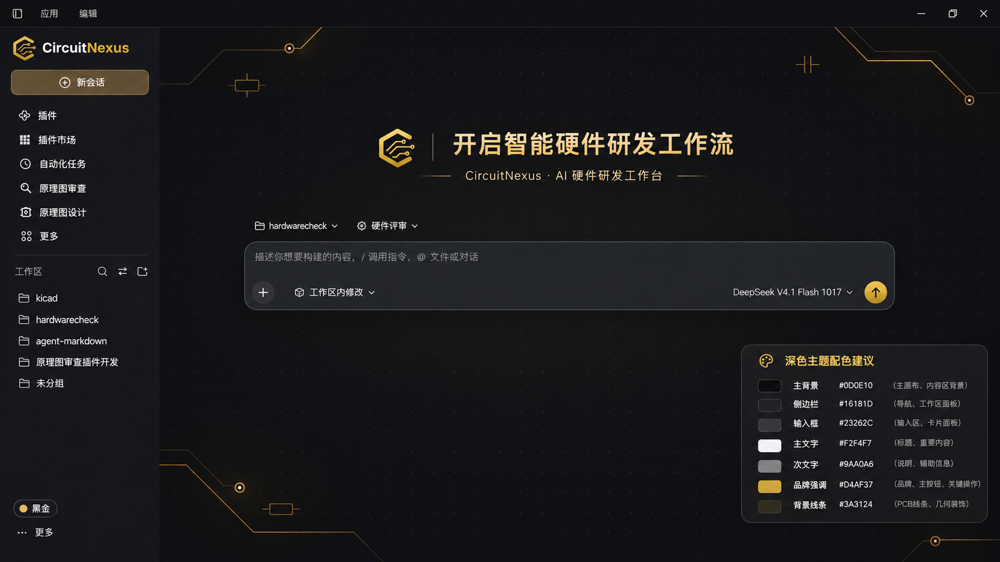
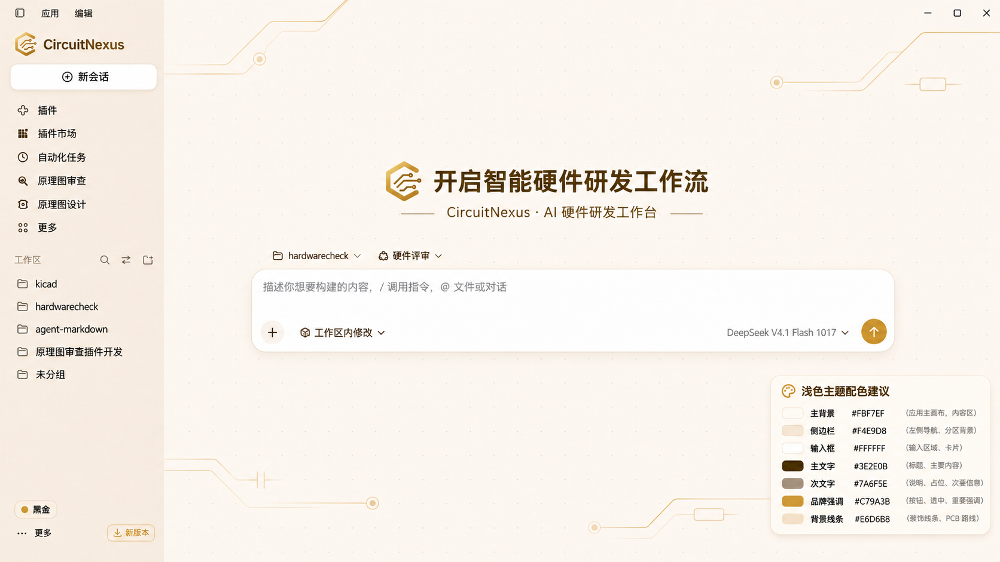
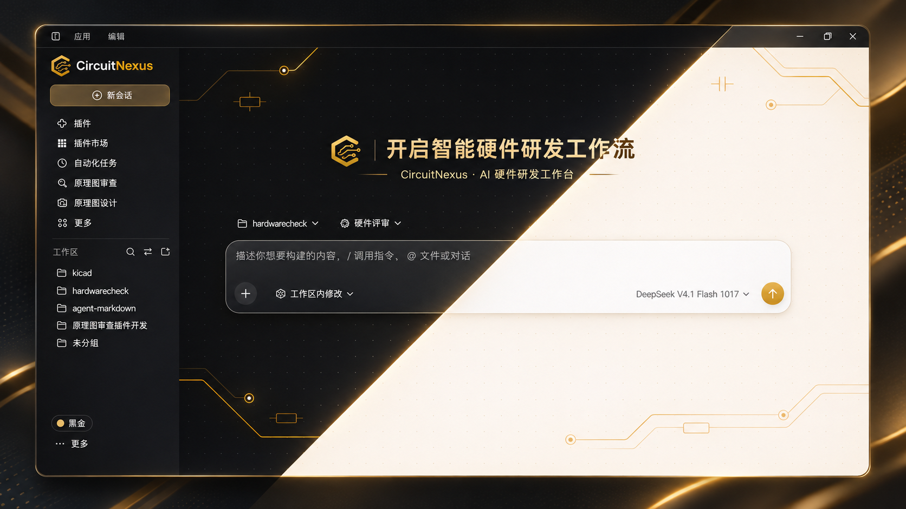

# CircuitNexus 桌面 UI 视觉基线 V1.1

> **生效日期**：2026-11-12。此文件针对已确认的两张客户端欢迎页原型与一张对角线双主题展示图；[通用 UI 规则](UI_GUIDELINES.md)、[品牌 Logo](BRAND_IDENTITY.md) 与 [主题 Token](../assets/tokens/) 仍为细节依据。
>
> **定位**：面向专业硬件工程师的 AI 硬件研发工作台；品牌 **CircuitNexus｜电路智枢**；视觉语言 **Precision Black & Gold｜精密黑金**。原型仅表示视觉规范，不代表功能开发状态。

## 1. 三张设计参考

| 设计参考 | 文件 | 使用目的 |
|---|---|---|
| 暗色应用欢迎页 | [dark-welcome.png](../assets/ui/prototypes/dark-welcome.png) | Dark 主题客户端基准 |
| 亮色应用欢迎页 | [light-welcome.png](../assets/ui/prototypes/light-welcome.png) | Light 主题客户端基准 |
| 黑金/暖白金对角拼合 | [theme-split-diagonal.png](../assets/ui/prototypes/theme-split-diagonal.png) | 网站宣传、发布页、功能介绍中的双主题对照；**不是实际客户端布局** |

**来源说明**：三张图来自本次设计会话生成的 UI 原型；图像是视觉参考，并非运行时真实截图。仓库中直接保存本轮三张原始 PNG 设计原型，非压缩二次生成图。原型属于视觉概念稿，不是实际运行截图。以 SVG Logo 和主题 Token 作为开发源，不从效果图抽取颜色。

## 2. 设计定稿内容

1. **品牌替换**：客户端左上角及首页标题使用 **CircuitNexus** 和金色开放 C 电路 Logo，发布版不再出现 **HardBuddy / H 芯片**。
2. **欢迎语**：主标题采用 **「开启智能硬件研发工作流」**；副标题采用 **「CircuitNexus · AI 硬件研发工作台」**。替代旧句「让我们一起来做硬件设计吧」；字体与字宽应使标题成为视觉中心。
3. **两套主主题**：Dark（深石墨黑 + 沉金）和 Light（暖纸白 + 香槟金）。两者保持相同布局、操作能力及信息语义。
4. **页面组织**：左侧常驻导航/工作区树、顶部菜单栏、居中欢迎语、下方任务类型/工作区选择与主输入框；用户流程优先，不重构官方通用交互。
5. **背景**：四周 PCB 金属走线 + 稀疏点阵，中央主要内容区保留空白，不干扰表格、网表和长文本。
6. **色板浮层**：原型右下角的“主题配色建议”卡片属于**设计展示辅助物**，不应进入正式欢迎页；只有主题设置页或 Design System 文档可以展示色板。
7. **展示图**：对角线由画面左下向右上延伸，**左上显示暗色、右下显示亮色**；保持同一产品布局，展示两种皮肤；分界线可用极轻的金色描边/柔光，不做强烈霓虹或明显扭曲。

## 3. 主题颜色（必须用设计 Token 实现）

| 语义 | Dark | Light | 备注 |
|---|---|---|---|
| 主画布 | `#0D0E10` | `#FBF7EF` | 低饱和背景 |
| 侧栏 | `#16181D` | `#F4E9D8` | 维持左右视觉层次 |
| 输入框 / 浮层 | `#23262C` | `#FFFFFF` | 保证可输入性与层级 |
| 主文字 | `#F2F4F7` | `#3E2E0B` | ≥4.5:1 目标 |
| 次文字 | `#9AA0A6` | `#6F6659` | 禁止暗灰低对比 |
| 品牌金 | `#D4AF37` | `#C79A3B` | CTA、选中、品牌 |
| 金色正文/小字 | `#D4AF37` | `#805C1E` | Light 品牌金不直接作为普通小字 |
| 纹理走线 | `#3A3124` | `#E6D6B8` | 不得压过内容 |
| 分割线 | `#34353A` | `#E9DCCC` | 弱分隔 |
| 导航选中 | `#3A3020` | `#EFE0C5` | 不用高饱和金填满侧栏 |

> 优先引用 [theme-tokens.css](../assets/tokens/circuitnexus-theme-tokens.css)，不得用截图采样色替代定稿色板。

## 4. 信息架构与构图约束

- **桌面参照画布**：原型 1672×941、宽屏比例约 16:9；实现采用响应式，不能把位图当作 UI。
- **主侧栏参考宽度**：246px（折叠 64px）；顶部应用菜单参考高度 42px；内容区横向居中，输入框最大宽度约 1000px。
- **品牌区**：左上端使用独立金色 SVG C + CircuitNexus 字标；分栏菜单/导航图标采用一致的光学视觉大小；在亮暗模式文字色适配。
- **主欢迎标题**：建议 30–38px（随窗口自适应）；中大尺寸屏幕视觉重心略高于垂直中心；不允许因为标语加长导致文本压到输入框。
- **副标题**：14–18px；比主标题轻，且不与正文操作争夺注意。
- **内容间距**：以 4px 作为最小栅格；8/12/16/24/32px 常用；卡片半径遵循 8/12/16px 分层。
- **输入区域**：主输入框是最高优先级交互面；边框轻、浮层阴影弱；右侧金色“提交”属于单一主要操作。
- **侧栏导航**：优先展示新会话、插件、插件市场、自动化任务、原理图审查、原理图设计、更多；工作区列表使用文件夹图标；文案以功能实际支持情况为准。
- **安全区域**：主输入框/主标题周围严禁高对比电路走线穿过；可用 `pointer-events:none` 的绝对定位 SVG 装饰图层。

## 5. PCB 背景制作与应用

- **原生 SVG 母版**：[暗色欢迎页](../assets/themes/pcb/circuitnexus-pcb-dark-welcome.svg)、[亮色欢迎页](../assets/themes/pcb/circuitnexus-pcb-light-welcome.svg)；可用对应透明 overlay 叠加到语义底色上。
- 走线主要位于四角；节点焊盘、少量电阻/电容符号可点缀，但不要成为主视觉。
- 深色欢迎页走线强调需克制，亮色走线为浅金；点阵仅供提供工程秩序感。
- 欢迎页显示装饰；**正常聊天、原理图/代码/报告/规则表格应压低到 4%–6% 的视觉强度或隐藏**。
- 窗口尺寸改变时线路不应切断控件边界；缩小时优先裁剪边缘装饰，不要缩小文字和输入框。
- 不使用动画导电线、强辉光、扫描特效作为常态背景。

## 6. 颜色与交互的约束

- 金色只承担品牌元素、一个主要 CTA 与少量选中标记；不要将所有按钮变成金色。
- 功能语义色与品牌色分离：错误 / 警告 / 通过 / 信息不以品牌金替代。
- 文本对比度优先满足 WCAG AA：普通正文 ≥4.5:1，重要控件视觉边界与图标 ≥3:1；需对真实叠加背景进行计算。
- Hover 主要通过浅层背景明度反馈；Focus 有清晰描边，Tab 导航可用；Disabled 与背景可区分但不伪装为可操作态。
- 菜单、输入框、侧栏、弹窗、原理图画布、检查报告等均需双主题回归检查。
- 主题切换不得引起布局抖动、文案宽度改变造成溢出或页面闪屏。

## 7. 设计稿与发布状态

本文件所配原型**只是设计目标**：并不代表 DeepSeek Harness 已集成这些 UI，亦不代表新品牌资源已应用于可安装产品。客户端实现后，应以运行截图进行对应位置对照验证，再将截图链接添加到 [状态记录](STATUS.md)。

**验收建议**：暗色/亮色欢迎页 × 100%/125%/150% 缩放，外加最窄支持窗口、长会话、插件加载失败、可访问性与深浅主题一致性，统一人工审查。
